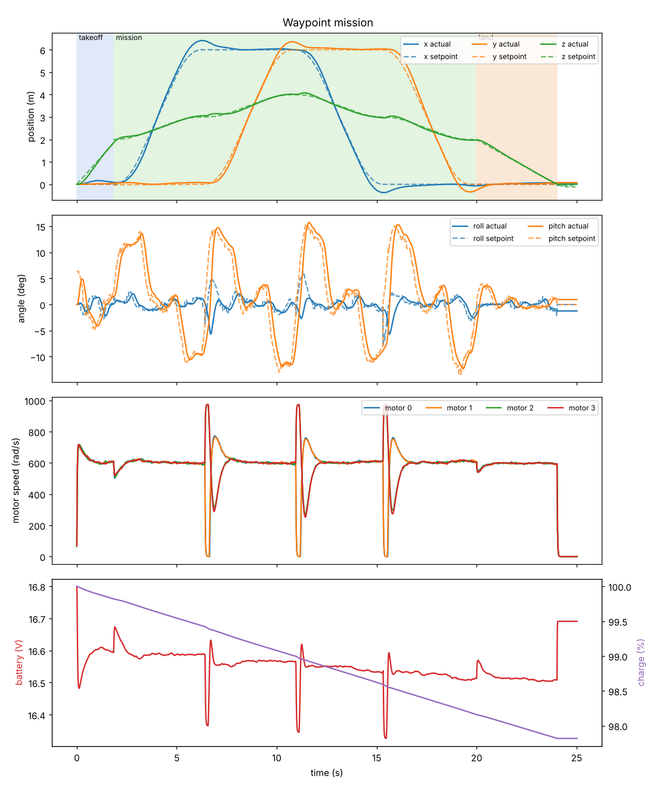

# Drone

A quadcopter simulator built from scratch in Python, for learning how drones
fly: the physics, motors, battery, sensors, state estimation, the flight
controller, path planning and flight modes. Each component is a short,
commented module with its own guide. It needs only numpy and matplotlib, and
runs on any laptop with no drone hardware.

```
        ┌──────────────────────── flight software ───────────────────────┐
        │                                                                │
 noisy  │  estimation ──► mission / ──► flight ──► mixer ──► motor       │
 sensor │  (where am I?)  planning      controller            commands ──┼──┐
 data   │                 (where to?)   (how?)                           │  │
   ▲    └────────────────────────────────────────────────────────────────┘  │
   │                                                                        ▼
   └──── sensors ◄── true state ◄── physics ◄── motors ◄── battery ◄────────┘
                           the real world (simulated)
```

**New to drones?** Start with the [guides](docs/README.md): one per component,
with diagrams, the maths explained in words, and results from this code.

## Quick start

```bash
cd Drone
python -m venv .venv && source .venv/bin/activate
pip install -r requirements.txt

python examples/04_waypoint_mission.py --gif    # a full autonomous flight
python -m pytest                                # 21 tests
```

Plots and animations are written to `output/`.

## Examples

| Script | What it shows | Guides |
|---|---|---|
| `01_hover_and_motors.py` | the drone's numbers, what the mixer does to each motor, hovering, flight time | 1, 4, 5 |
| `02_pid_tuning.py` | the same manoeuvre with sluggish, good and unstable gains | 8 |
| `03_sensors_and_estimation.py` | noisy sensors vs the estimators vs the truth | 6, 7 |
| `04_waypoint_mission.py` | take off, fly a route with yaw along the path, land (`--gif` for an animation) | 9, 10, 11 |
| `05_path_planning.py` | A* around obstacles with a safety margin, then flying the route | 9 |
| `06_wind_and_battery.py` | hovering in wind with and without the integral term; low-battery failsafe | 5, 8 |

## Results from the examples

| | Result |
|---|---|
| Hover | 601 rad/s per motor, 60% of max; 9.5 A; about 19 minutes on a full battery |
| Step response, default gains | 3 m move: rise time 0.87 s, overshoot 7 cm |
| Position estimate | 0.08 m mean error, from GPS readings with 0.97 m mean error |
| Attitude estimate | 0.19° mean roll/pitch error |
| Waypoint mission | 0.20 m mean tracking error; landed 0.1 m from the target |
| Path planning | 153-cell A* path shortened to 12 waypoints; closest approach 0.70 m (margin 0.6 m) |
| Wind (4 m/s + gusts) | holds position to within 0.02 m on average, using the integral term |



## Lessons found while building it

Three real bugs surfaced in testing, and each is now explained in the guides
because they teach how drones work:

1. **The drone flipped over** on its first flight using estimated state. A
   quadcopter's accelerometer can't sense tilt while the drone accelerates,
   and the filter trusted it too much. ([State estimation](docs/07-state-estimation.md))
2. **It overshot every corner by over a metre**, coming within 1 cm of a
   wall. The setpoint stopped dead at waypoints, and a drone can't. ([Navigation](docs/09-navigation-and-planning.md))
3. **It flew tilted 26° in wind** when the gyro calibrated while the drone
   was moving, which is why real drones must be still while booting. ([Simulation loop](docs/11-the-simulation-loop.md))

## Code map

| File | Component | Guide |
|---|---|---|
| [`drone/params.py`](drone/params.py) | the drone's physical numbers | [1](docs/01-drone-hardware.md) |
| [`drone/rotations.py`](drone/rotations.py) | quaternions, rotation matrices, Euler angles | [2](docs/02-frames-and-rotations.md) |
| [`drone/dynamics.py`](drone/dynamics.py) | rigid-body physics, RK4, ground contact | [3](docs/03-physics.md) |
| [`drone/motors.py`](drone/motors.py) | propellers, allocation matrix, mixer, motor lag | [4](docs/04-motors-and-mixing.md) |
| [`drone/battery.py`](drone/battery.py) | LiPo voltage, sag and charge | [5](docs/05-battery.md) |
| [`drone/sensors.py`](drone/sensors.py) | IMU, magnetometer, barometer, GPS with noise | [6](docs/06-sensors.md) |
| [`drone/estimation.py`](drone/estimation.py) | complementary filter, Kalman filter, gyro calibration | [7](docs/07-state-estimation.md) |
| [`drone/control.py`](drone/control.py) | PID and the position → velocity → attitude → rate cascade | [8](docs/08-control.md) |
| [`drone/planning.py`](drone/planning.py) | occupancy grid, A*, shortcutting, waypoint follower | [9](docs/09-navigation-and-planning.md) |
| [`drone/mission.py`](drone/mission.py) | flight modes and the low-battery failsafe | [10](docs/10-flight-modes.md) |
| [`drone/simulation.py`](drone/simulation.py) | the loop connecting everything; flight log | [11](docs/11-the-simulation-loop.md) |
| [`drone/plots.py`](drone/plots.py) | flight, estimation, 3D and map plots; GIF animation | [11](docs/11-the-simulation-loop.md) |
| [`tests/`](tests/) | 21 tests: physics, mixer, rotations, filters, PID, A*, full missions | |

Suggested reading order for the code: `params.py` → `dynamics.py` →
`motors.py` → `control.py` → `simulation.py`, then the rest.

## Conventions

World frame: x east, y north, z up. Body frame: x forward, y left, z up.
Units are SI throughout (metres, seconds, radians, newtons). PX4 and
ArduPilot use z-down frames (NED/FRD) instead; see [guide 2](docs/02-frames-and-rotations.md).
