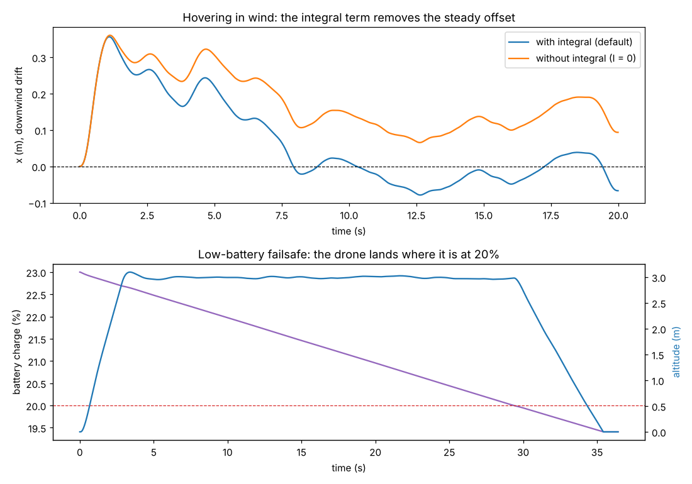

# 5. The battery

**Code:** [`drone/battery.py`](../drone/battery.py) · **Test:** `test_battery_drains_and_sags` · **Examples:** [`01_hover_and_motors.py`](../examples/01_hover_and_motors.py), [`06_wind_and_battery.py`](../examples/06_wind_and_battery.py)

## What it is

Drones almost always use **lithium-polymer (LiPo)** batteries: light for
the energy they hold, and able to deliver high currents. A pack is several
cells in series, written "4S" for four cells. This drone has a 4S 3,000 mAh
pack: 14.8 V nominal, 16.8 V full.

## Three things the model captures

### 1. Voltage falls as the battery empties

A resting cell reads about 4.2 V full, 3.8 V half-full and 3.3 V empty, with
a steep drop at the end (`CELL_VOLTAGE_POINTS`):

```
 4.2 V ┤╲
       │ ╲___
 3.8 V ┤     ╲______________
       │                    ╲__
 3.5 V ┤                       ╲
 3.3 V ┤                        ╲
       └──────────────────────────── charge used
       full                     empty
```

Draining a LiPo below about 3.3 V per cell permanently damages it, which is
one reason drones land with charge to spare.

### 2. Voltage sags under load

A battery has internal resistance (20 mΩ here). Drawing current I loses
I × R volts inside the battery:

```
terminal voltage = resting voltage − current × internal resistance
```

In the mission plot, every hard manoeuvre shows as a sharp dip in battery
voltage. Under heavy load a battery can look much emptier than it is, so
reading charge from voltage alone is unreliable. Real drones also count the
current going out (coulomb counting), as `Battery.draw` does.

### 3. Lower voltage means less thrust available

A brushless motor's top speed is roughly proportional to voltage. The
simulator scales each motor's maximum speed by `voltage_fraction()`, so as the
battery drains and sags, the drone has less spare thrust for climbing,
fighting wind or recovering from a gust. This is why drones feel sluggish
near the end of a flight.

## Power and flight time

```
propeller power   = Σ k_m · ω³                  (mechanical, at the props)
electrical power  = propeller power / efficiency   (60%: motors and ESCs waste the rest as heat)
current           = electrical power / voltage
```

Hovering, this drone draws about 9.5 A, so a full 3 Ah battery lasts about
19 minutes, though nobody flies it to empty.

## Low-battery failsafe

`Mission` lands automatically when the charge drops below `low_battery` (20%).
Example 6 starts a long mission at 23%; the failsafe triggers about 29 seconds
in, and the drone lands where it is. See [Flight modes](10-flight-modes.md).



## Try it

Set `battery_capacity_mah = 5000` and `mass = 1.2` (a bigger battery is
heavier). Does hover time go up or down? Bigger batteries have diminishing
returns: the extra weight needs extra power.
