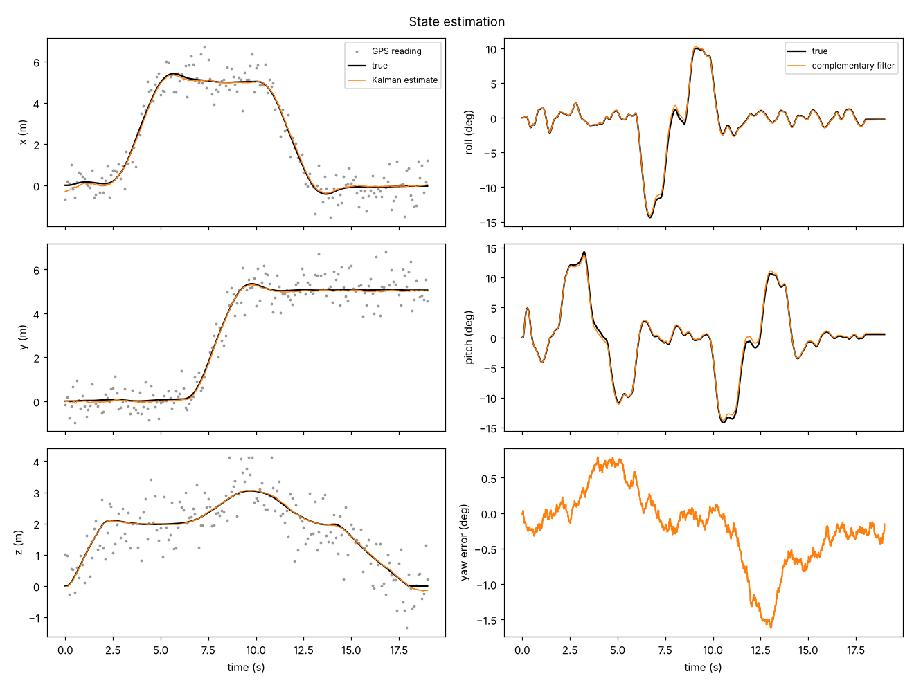

# 7. State estimation: combining imperfect sensors

**Code:** [`drone/estimation.py`](../drone/estimation.py) · **Tests:** `test_angles_from_accelerometer_and_magnetometer`, `test_complementary_filter_removes_gyro_drift`, `test_kalman_filter_beats_raw_gps` · **Example:** [`03_sensors_and_estimation.py`](../examples/03_sensors_and_estimation.py)

## What it is

The controller needs to know the drone's attitude, position and velocity,
hundreds of times a second. No sensor provides that. Estimation fuses them
into one best guess, the `Estimate`.

The core idea: **combine a sensor that's smooth but drifts with one that's
noisy but doesn't drift.**

| | Smooth, short-term, drifts | Noisy, long-term, stable |
|---|---|---|
| Attitude | integrating the gyroscope | accelerometer tilt, magnetometer heading |
| Position | integrating the accelerometer | GPS, barometer |

Two estimators run side by side:

## 1. Attitude: the complementary filter (`AttitudeEstimator`)

Every step:

```
angle = angle + (rate from gyro) × dt                             trust the gyro short-term
angle = angle + (dt / time constant) × (angle from accel/mag − angle)   nudge toward the absolute sensor
```

The **time constant** decides the blend. Over times much shorter than it, the
gyro dominates; over longer times, the absolute sensor wins. It's called
complementary because it's a high-pass filter on the gyro plus a low-pass
filter on the accelerometer, and the two add to exactly one.

The gyro gives body rates (p, q, r), which aren't the same as rates of roll,
pitch and yaw once the drone is tilted. `euler_rates` converts them.

### A lesson from building this: the accelerometer trap

The first version used a 0.1-second tilt time constant, common in tutorials
for handheld IMUs. The drone **flipped over** in its first estimated flight.

Why: on a quadcopter, the accelerometer reads mostly thrust, which points
along the body z axis whatever the tilt (see [Sensors](06-sensors.md)). So
whenever the drone tilted to accelerate, the filter was told "you're level",
and believed it within a fraction of a second. The controller, thinking it was
level, tilted further. It's a runaway loop.

The fixes, in order of how much they helped:

| Change | Worst tilt-estimate error | Overshoot at a corner |
|---|---|---|
| 0.1 s time constant | the drone flipped (138°) | – |
| 5 s time constant | 3.8° | 1.53 m |
| + gyro calibration and a 20 s time constant | **0.85°** | 0.78 m |
| (for comparison: controller given the true state) | – | 0.54 m |

**Gyro calibration** (`_calibrate`): for the first second, the drone sits
still, and the average gyro reading *is* the bias. Subtract it, and the gyro
barely drifts, so the accelerometer correction can be very gentle (20 s).
Real autopilots solve this properly with an EKF that uses GPS velocity to
work out the true acceleration, so the accelerometer's tilt information
becomes usable even in flight.

## 2. Position: the Kalman filter (`PositionEstimator`)

A Kalman filter tracks two things:

* **x**, the estimate: [position, velocity], 6 numbers.
* **P**, the uncertainty: a 6×6 covariance matrix, roughly "how wrong x might be".

It alternates two steps:

**Predict** (every IMU reading, 500 Hz). Use physics to move the estimate
forward:

```
acceleration = R · accelerometer + gravity      (rotate to the world; add gravity back)
position    += velocity·dt + ½·acceleration·dt²
velocity    += acceleration·dt
P grows                                        (integrating noisy acceleration adds doubt)
```

**Update** (when GPS or the barometer reads). Compare the measurement with
what the estimate expected:

```
innovation = measurement − expected measurement          the surprise
K          = P·Hᵀ·(H·P·Hᵀ + R)⁻¹                         the Kalman gain
x         += K · innovation                              move toward the measurement...
P shrinks                                                ...and become more certain
```

The **Kalman gain** K is the clever part: it weighs the estimate's
uncertainty (P) against the sensor's (R). Unsure of the estimate, or a
precise sensor: trust the measurement. Confident, or a noisy sensor: barely
move. It's automatic, per axis, and the optimal blend when the noise is
Gaussian. **H** picks out what each sensor sees: GPS sees all six numbers,
the barometer only altitude.

The filter starts from the first GPS fix rather than (0, 0, 0), so it
doesn't begin with a huge error.

## Results (example 3)

| | Mean error | Worst error |
|---|---|---|
| Raw GPS readings | 0.97 m | 2.11 m |
| **Kalman filter** | **0.08 m** | **0.29 m** |
| Roll/pitch (complementary filter) | 0.19° | 0.87° |
| Yaw | 0.41° | 1.62° |

The Kalman estimate is about 12× more accurate than the GPS it's built
from, because the accelerometer fills in the smooth motion between GPS
readings and the filter averages the GPS noise over many readings.



## What real autopilots do differently

PX4's **EKF2** and ArduPilot's **EKF3** are Extended Kalman Filters with about
24 states: attitude, velocity, position, gyro and accelerometer biases,
Earth's magnetic field, wind, and more, all in one filter. "Extended" means
they handle non-linear equations (like rotations) by linearizing around the
current estimate. They also delay-compensate GPS and reject wild readings
("innovation gating"). The two filters here are the same ideas, small
enough to read in one sitting.

## Try it

* Set `calibration_time=0.001` in `AttitudeEstimator` to effectively skip
  calibration, then rerun example 3. Watch the tilt error.
* Set `tilt_time_constant=0.1` and rerun example 4, and you'll reproduce the
  flip described above.
