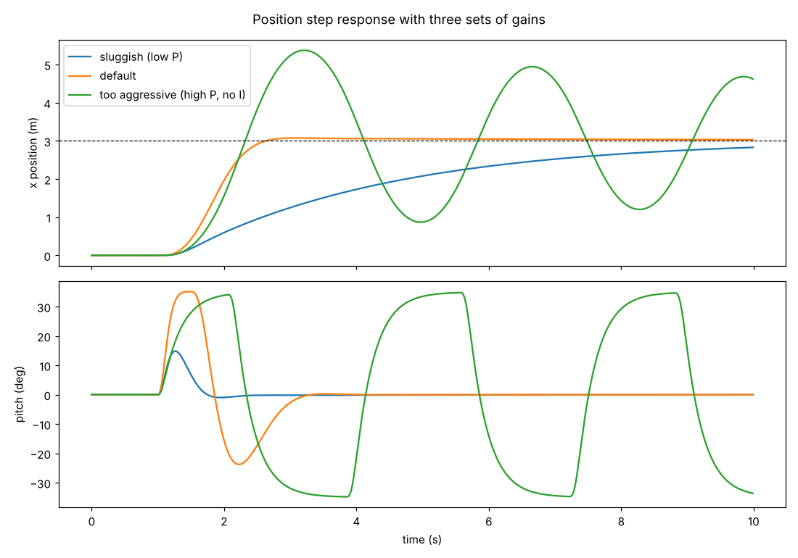

# 8. Control: PID loops and the cascade

**Code:** [`drone/control.py`](../drone/control.py) · **Tests:** `test_pid_terms`, `test_pid_integral_limit`, `test_acceleration_to_attitude` · **Examples:** [`02_pid_tuning.py`](../examples/02_pid_tuning.py), [`06_wind_and_battery.py`](../examples/06_wind_and_battery.py)

## The problem

The flight controller must turn "be at (6, 6, 4)" into four motor speeds,
500 times a second, while the drone is unstable, the motors lag, the
estimate is imperfect and the wind pushes. It does this with a **cascade of
simple controllers**, each solving one small problem.

## The PID controller (`PID`)

The workhorse of control engineering:

```
output = Kp · error  +  Ki · ∫ error dt  +  Kd · d(error)/dt
           (P)            (I)                 (D)
```

| Term | Reacts to | Effect | Too much of it |
|---|---|---|---|
| **P**roportional | how far off we are now | pushes toward the target | overshoot and oscillation |
| **I**ntegral | how long we've been off | removes steady offsets (wind, a heavy side) | slow wobbles, overshoot after a disturbance |
| **D**erivative | how fast the error changes | brakes; damps oscillation | amplifies sensor noise; jittery motors |

Practical details in `PID`, all found in real flight code:

* **Derivative on measurement**: D uses the change in the *measurement*, not
  the error. Otherwise a sudden change of setpoint makes the error jump, and
  D produces a huge spike ("derivative kick").
* **Anti-windup**: the integral is clamped. While the drone sits on the
  ground or the motors are saturated, the error can't shrink, so an
  unclamped integral grows huge and causes a violent overshoot later. The
  simulator also resets integrals while on the ground.
* **Output limits.**

## The cascade (`FlightController`)

```
 position setpoint
      │  PositionController   P      error (m)       → velocity setpoint (m/s)     limited to 5 m/s across, 2 up/down
      ▼
 velocity setpoint
      │  VelocityController   PID    error (m/s)     → acceleration setpoint (m/s²)
      ▼
 acceleration_to_attitude           acceleration    → desired attitude + thrust   tilt limited to 35°
      ▼
      │  AttitudeController   P      attitude error  → body-rate setpoint (rad/s)   limited to 220°/s
      ▼
      │  RateController       PID    rate error      → torques (N·m)
      ▼
 thrust + torques → Mixer → 4 motor speeds
```

**Why cascade?** Each loop solves a simple, nearly linear problem. Inner loops
are much faster than outer ones, so from the outside each inner loop just
looks like "it does what it's told, quickly". You tune from the inside out:
rate loop first, then attitude, velocity and position. PX4 and ArduPilot use
this exact structure; the rate loop on real drones often runs at 1–8 kHz.

### The key step: acceleration → attitude

A quadcopter can only push along its own z axis. So to get acceleration
**a**, the thrust *vector* must be

```
thrust vector = mass × (a − gravity) = mass × (a + (0, 0, 9.81))
```

Its **direction** becomes the desired body z axis (how to tilt); its length
is the thrust. The yaw setpoint then fixes the rotation about that axis. If
the tilt would exceed 35°, the horizontal part is scaled down: the drone
accelerates less rather than tilting so far it loses height.

The thrust actually commanded is projected onto where the body z axis points
*now* (`thrust_vector · current body z`). While the drone is still rotating
toward the new tilt, it doesn't push hard in the wrong direction.

### The attitude error

`AttitudeController` uses the quaternion error q_err = q⁻¹ ⊗ q_desired.
Twice its vector part is the rotation needed about each *body* axis, which
is exactly the frame the rate loop works in, with no Euler-angle
singularities. If q_err.w < 0, it's negated, to turn the short way round.

### Inertia scaling in the rate loop

`RateController` outputs an angular *acceleration*, multiplied by the inertia
matrix to get torque. The gains then mean the same thing on every axis,
even though yaw has nearly twice the inertia. It also adds the gyroscopic
term ω × Iω, cancelling it before it disturbs anything.

## Tuning: what gains do (example 2)

The drone is asked to move 3 m sideways, with three sets of gains:

| Gains | Rise time | Overshoot | Settles (±5 cm) |
|---|---|---|---|
| sluggish (position P 0.3) | 6.7 s | 0 cm | not within 10 s |
| **default** | **0.87 s** | **7 cm** | **4.6 s** |
| too aggressive (high P, no I, weak attitude loop) | 0.71 s | 237 cm | never: it oscillates |



The aggressive set shows the classic cascade failure: the outer loop asks
for changes faster than the inner (attitude) loop can deliver, so it's always
reacting to old information, and the swing grows until the tilt limit holds
it in a steady oscillation.

How the default gains were chosen: the mission's corner overshoot was
measured with a few candidate sets, and stiffer position and velocity
gains (P 1.5 and 3.5) cut it from 0.78 m to 0.47 m with no extra tilt.

## Integral action against wind (example 6)

Hovering in a 4 m/s wind with gusts, the drone must lean into the wind
(about 5°) just to stay put.

| | Average drift downwind |
|---|---|
| with the velocity loop's I term | −0.02 m |
| without it (I = 0) | 0.12 m |

Without I, the controller needs a steady *error* to produce the steady lean,
so it settles downwind of its target. The integral builds up that lean by
itself and drives the offset to zero.

## Try it

* In example 2, add a gain set with `rate_d=np.zeros(3)`. What does the
  attitude do without D in the rate loop?
* Halve `attitude_p`. The outer loops are unchanged, but the drone gets
  worse at positioning: the cascade only works when inner loops are fast.
