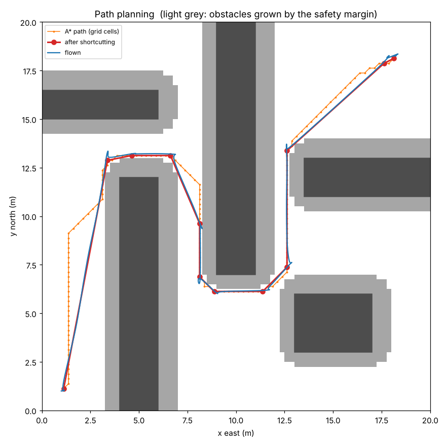
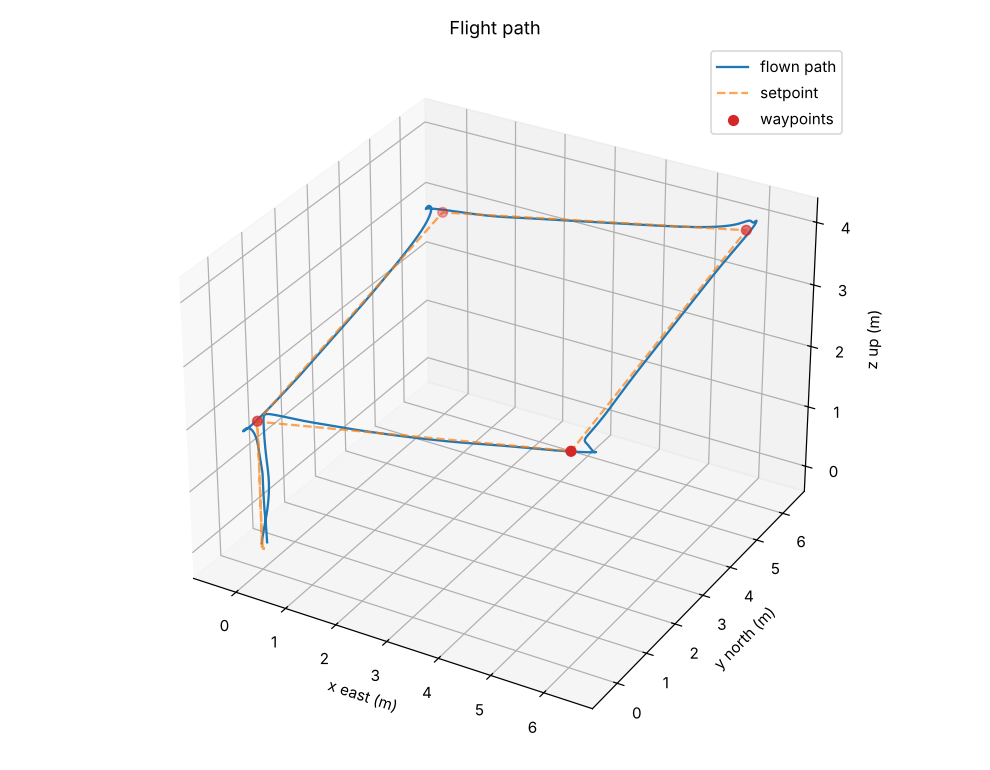

# 9. Navigation and path planning

**Code:** [`drone/planning.py`](../drone/planning.py) · **Tests:** `test_astar_avoids_walls`, `test_astar_reports_no_path`, `test_waypoint_follower_speed_profile` · **Examples:** [`04_waypoint_mission.py`](../examples/04_waypoint_mission.py), [`05_path_planning.py`](../examples/05_path_planning.py)

## Two layers

| Layer | Question | Runs | Code |
|---|---|---|---|
| **Planning** | Which route avoids the obstacles? | once, or occasionally | `astar`, `shortcut_path` |
| **Following** | Where should the drone be *right now*? | every control step | `WaypointFollower` |

## The map: an occupancy grid

The area is divided into square cells (25 cm here), each free or blocked
(`OccupancyGrid`). It's the simplest map representation, and widely used:
real drones build these from depth cameras or lidar as they fly.

### Inflating obstacles

Planning for a point is easy; a drone has size, and its position estimate
has error. The trick: **grow every obstacle** by a safety margin (`inflate`),
then plan for a point. Example 5 grows them by 0.6 m (the light grey in the
map below).

The first version used `np.roll` to grow obstacles, which wraps around the
map's edges, so obstacles touching one edge produced phantom obstacles on
the opposite edge. Padding the grid first fixed it.

## A* search (`astar`)

A* finds the shortest path through the grid. It explores cells in order of

```
f(cell) = g(cell) + h(cell)
          cost so far   estimated cost to go (straight-line distance)
```

always expanding the most promising cell next. Because the straight-line
estimate never *over*estimates the true remaining distance, the first time
A* reaches the goal, it has found the shortest path. Compared with exploring
blindly (Dijkstra's algorithm), the estimate h focuses the search toward the
goal.

Details in the code:

* **8-connected**: moves to all 8 neighbours, diagonals costing √2.
* **No corner cutting**: a diagonal step between two blocked cells isn't allowed.
* A priority queue (`heapq`) keeps the cheapest cell on top; stale queue
  entries are skipped instead of updated.
* It returns `None` when no path exists, and callers must handle that.

## Shortcutting (`shortcut_path`)

Grid paths zig-zag along cell edges: 153 cells in example 5. Flown literally,
that's slow and jerky. Shortcutting jumps from each waypoint to the
**furthest** later waypoint still in a clear line of sight (`line_is_free`),
leaving 12 waypoints:



The flown track (blue) follows the shortened route closely and never came
closer than **0.70 m** to an obstacle, outside the 0.6 m planned margin.

## Following the route (`WaypointFollower`)

Jumping the setpoint straight to the next waypoint would make the position
controller sprint flat out, then overshoot. Instead, a **"carrot"** slides
along each leg and the drone chases it. The carrot's velocity is passed on
as feedforward, so the drone starts moving with it instead of waiting to
fall behind.

### The trapezoidal speed profile

```
 speed
 cruise ┤    ┌────────────┐
        │   ╱              ╲        speed up at 1.5 m/s², cruise,
        │  ╱                ╲       then slow down to stop exactly
      0 ┼─┴──────────────────┴──    at the waypoint
          start            waypoint
```

The speed at each moment is the smallest of: the last speed plus
acceleration × dt, the cruise speed, and the **stopping speed**
√(2·a·distance), the fastest speed from which it can still stop at the
waypoint.

Another lesson from building this: the first follower ran at full cruise
speed right up to each waypoint, then stopped dead. A 1 kg drone at 2.5 m/s
can't stop instantly, so it overshot every corner by over a metre, and came
within 0.01 m of a wall. The profile, together with gyro calibration and
retuned gains, fixed that:

| Version | Mission tracking error (mean / worst) | Closest approach to an obstacle |
|---|---|---|
| full speed to each waypoint | 0.76 m / 1.61 m | 0.01 m |
| **trapezoidal profile + calibration + retuning** | **0.20 m / 0.42 m** | **0.70 m** |

The follower moves to the next waypoint only when both the carrot has
arrived and the drone is within the `acceptance_radius` (0.3 m).

**Yaw along the path** (`yaw_along_path=True`) points the nose along each
leg, as a camera drone would. Each 90° turn briefly saturates the motors
(see [Motors and mixing](04-motors-and-mixing.md)).



## What real drones add

* **3D planning** (voxel grids, octrees) instead of fixed-altitude 2D.
* **Smooth trajectories**: minimum-snap polynomials through the waypoints,
  so the drone never has to stop at corners.
* **Replanning** as new obstacles appear in the drone's sensors.
* **Sampling-based planners** (RRT, RRT*) for large, high-dimensional spaces.

## Try it

* In example 5, change `grid.inflate(0.6)` to `0.2`, then `1.5`. How do the
  route and its length change? At some value, there's no route at all.
* Set `max_acceleration=5.0` in `WaypointFollower` and rerun example 4.
  Watch the corner overshoot return.
