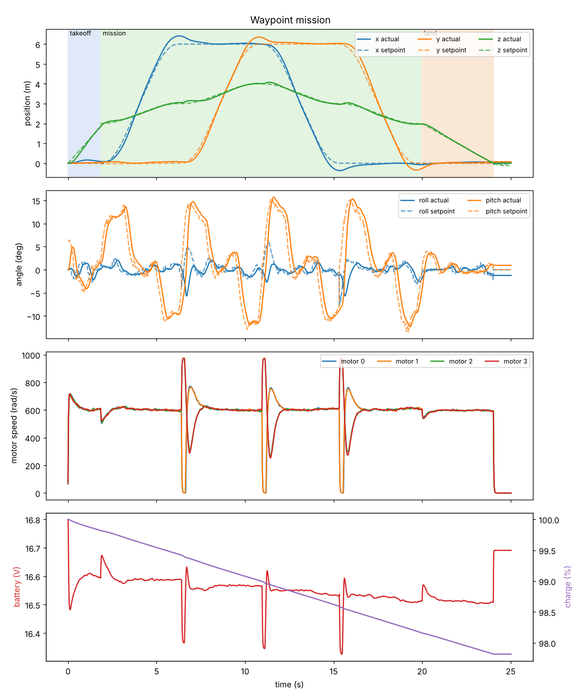

# 11. The simulation loop

**Code:** [`drone/simulation.py`](../drone/simulation.py), [`drone/plots.py`](../drone/plots.py) · **Test:** `test_full_mission_with_estimator` · **Example:** [`04_waypoint_mission.py`](../examples/04_waypoint_mission.py)

## What it is

`Simulator.run` ties every component together. Each 2 ms step runs in the
same order as a real drone's software:

```
 ┌─────────────────────────────── one step (2 ms) ──────────────────────────────┐
 │                                                                               │
 │  true state ─► sensors ─► estimator ─► mission ─► flight controller ─► mixer  │
 │      ▲                                                                  │     │
 │      └──── physics ◄── thrust & torques ◄── motors ◄── battery limit ◄──┘     │
 └───────────────────────────────────────────────────────────────────────────────┘
```

1. **Sense**: `Sensors.read` turns the true state into noisy readings.
2. **Estimate**: `StateEstimator.update` turns readings into an `Estimate`.
3. **Decide**: `Mission.update` picks the setpoint for this moment.
4. **Control**: `FlightController.update` turns setpoint + estimate into thrust and torques.
5. **Mix**: `Mixer.motor_speeds` turns those into motor commands, capped by battery voltage.
6. **Actuate**: `Motors.update` moves the motor speeds toward the commands (with lag).
7. **Physics**: battery drains, wind updates, and `QuadcopterDynamics.step` moves the drone.

## Two worlds, kept apart

Steps 1–5 are **flight software**: they only see sensor readings. Steps 6–7
are the **real world**: they own the true state. Keeping this boundary is what
makes a simulation honest. Code that accidentally reads the true state
"works" in simulation and fails on a real drone.

`SimConfig(use_estimator=False)` breaks the boundary on purpose: the
controller gets the true state. That's useful for learning control by
itself (examples 1 and 2 do this), and for measuring how much estimation
errors cost. In the corner test, the overshoot was 0.54 m with the truth and
0.78 m with the estimator before retuning.

## Time steps and rates

Everything runs at 500 Hz (dt = 2 ms), except the slow sensors (GPS 10 Hz,
barometer and magnetometer 50 Hz).

Choosing dt is a trade-off:

* **Too large**: the physics becomes inaccurate, and digital control loops
  become unstable. A controller acting on 20 ms-old information can't
  stabilize a drone that rotates noticeably in 20 ms.
* **Too small**: slow. A 30-second flight is 15,000 steps; in Python, that
  takes a few seconds.

Real flight controllers run loops at different rates: the rate loop at
1–8 kHz, attitude at about 250 Hz, position at about 50 Hz. A good extension
is to run each controller in this simulator at its own rate.

## Pre-flight calibration

Before the clock starts, `_preflight_calibration` holds the drone still while
the estimator measures the gyro bias. For flights that start on the ground,
that's exactly what a real drone does at power-on. For flights that start
in mid-air (examples 1, 2 and 6), it's as if the drone was calibrated before
being placed there.

An early version calibrated *during* the flight. Hovering in wind, the drone
was already being pushed around, so the "bias" it measured was real motion,
and it flew tilted 26°. It's a nice demonstration of why drones insist on
being still while they boot.

## Wind

`SimConfig(wind=...)` sets a steady wind. `gust_strength` adds random gusts
that wander smoothly over time (an Ornstein-Uhlenbeck process: each step,
the gust decays toward zero and gets a small random kick). Wind enters the
physics through drag, which depends on velocity relative to the air.

## The flight log

Every 5th step, `FlightLog` records the true state, estimate, setpoints,
motor speeds, battery and mode. After the flight, `finish()` turns each
field into a numpy array (`log.position` is N×3, and so on), ready for
analysis or plotting:

| Plot | Function | Shows |
|---|---|---|
| Flight overview | `plot_flight` | position vs setpoint, attitude vs setpoint, motors, battery; mode bands |
| Estimation | `plot_estimation` | truth vs estimate vs raw GPS; attitude estimate |
| 3D path | `plot_3d` | flown path, setpoint and waypoints |
| Map | `plot_map` | obstacles, A* path, shortcut path, flown track |
| Animation | `animate` | the drone's body moving along its path (GIF) |

Real drone developers spend much of their time on plots like these (PX4's
Flight Review, ArduPilot's log viewer). The setpoint-vs-actual plot for each
loop is the first thing to look at when something flies badly.



## Try it

```bash
python examples/04_waypoint_mission.py --gif      # writes output/04_mission.gif
```

Then write your own mission in a few lines:

```python
from drone.mission import Mission
from drone.simulation import Simulator, SimConfig
from drone.plots import plot_3d
log = Simulator(config=SimConfig(wind=[2, 1, 0], gust_strength=0.5)).run(
    Mission([[5, 0, 3], [5, 5, 5], [0, 0, 2]]))
plot_3d(log, "output/my_flight.png")
```
