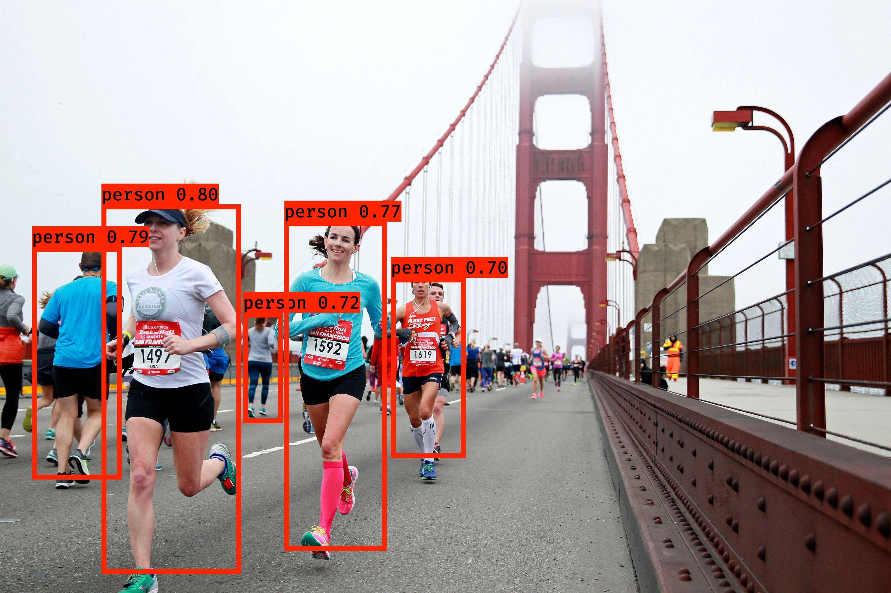
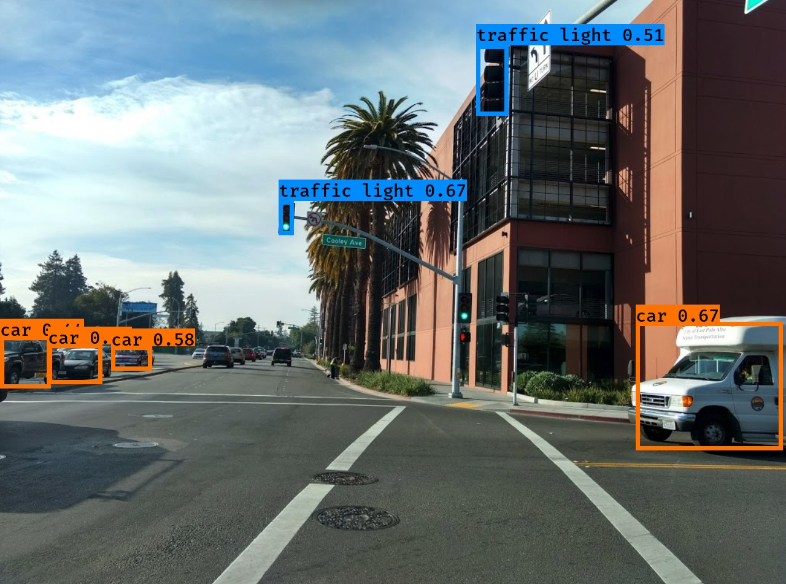
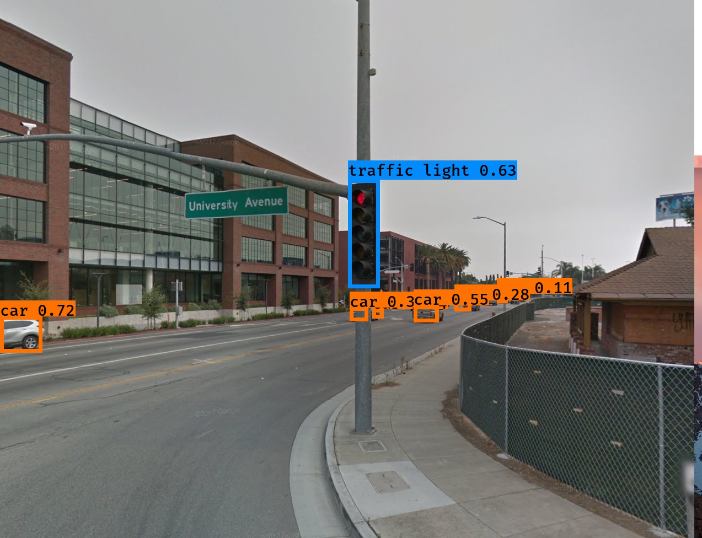

## This repo contains various deep learning model implementations

# SmallLM/

### [README](https://github.com/cnv1989/DeepLearning/tree/master/SmallLM)

A complete LLM training pipeline in PyTorch, built from scratch: BPE tokenizer training, data cleaning and deduplication, a Llama-style transformer (RoPE, RMSNorm, SwiGLU, grouped-query attention, KV cache), multi-GPU pretraining, supervised fine-tuning, GRPO with verifiable or learned rewards, a reward model, DPO, evaluation and tests. The tiny config trains on a CPU in minutes.

# Lambdas/

Contains code that host trained models on AWS lambda. The lambdas are exposed via API gateway to enable classification trough APIs

## [Lambdas/Lenet5Lambda](https://github.com/cnv1989/DeepLearning/tree/master/Lambdas/Lenet5Lambda)

Lenet5Lambda is implemented using Serverless Framework.

# Lenet5/

### [Notebook](https://github.com/cnv1989/DeepLearning/blob/master/Lenet5/Lenet5.ipynb)

Tensorflow implementation of Lenet5 model for handwritten digit recognition.

# Resnet/

### [Notebook](https://github.com/cnv1989/DeepLearning/blob/master/Resnet/ResNet.ipynb)
### [Training Script](https://github.com/cnv1989/DeepLearning/blob/master/Resnet/resnet50_train.py)

Implented modified Resnet50 (by pruning the last residual block) for classifying CIFAR-10 dataset since resnet50 is built for 64x64 images while cifar-10 as has 32x32 images.

# YOLO/

### [Notebook - Convert YAD2K model to Keras](https://github.com/cnv1989/DeepLearning/blob/master/YOLO/YOLO.ipynb)
### [Notebook - Evaluate YOLO](https://github.com/cnv1989/DeepLearning/blob/master/YOLO/Evaluate.ipynb)

Takes YAD2K configuration and weights and converts to Keras. Applies box filtering and non max supression on the output of the model. 

