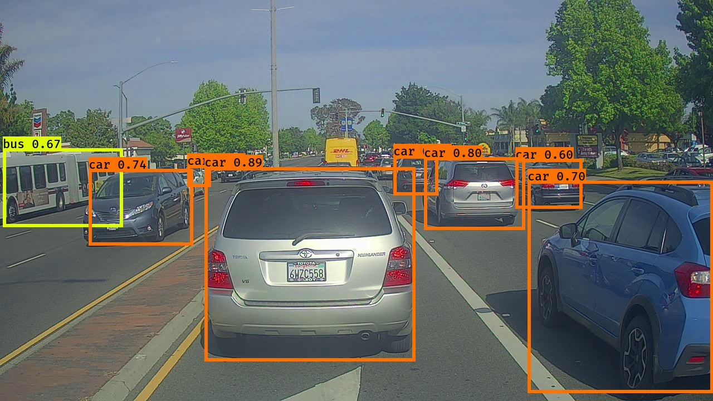

## This repo contains various deep learning model implementations

# Lambdas/

Contains code that host trained models on AWS lambda. The lambdas are exposed via API gateway to enable classification trough APIs

## [Lambdas/Lenet5Lambda](https://github.com/cnv1989/DeepLearning/tree/master/Lambdas/Lenet5Lambda)

Lenet5Lambda is implemented using Serverless Framework.

# Lenet5/

### [Notebook](https://github.com/cnv1989/DeepLearning/blob/master/Lenet5/Lenet5.ipynb)

Tensorflow implementation of Lenet5 model for handwritten digit recognition.

# Resnet/

### [Notebook](https://github.com/cnv1989/DeepLearning/blob/master/Resnet/ResNet.ipynb)
### [Training Script](https://github.com/cnv1989/DeepLearning/blob/master/Resnet/resnet50_train.py)

Implented modified Resnet50 (by pruning the last residual block) for classifying CIFAR-10 dataset since resnet50 is built for 64x64 images while cifar-10 as has 32x32 images.

# YOLO/

### [Notebook - Convert YAD2K model to Keras](https://github.com/cnv1989/DeepLearning/blob/master/YOLO/YOLO.ipynb)
### [Notebook - Evaluate YOLO](https://github.com/cnv1989/DeepLearning/blob/master/YOLO/Evaluate.ipynb)

Takes YAD2K configuration and weights and converts to Keras. Applies box filtering and non max supression on the output of the model. 

# TinyLM/

### [Course: a language model in silicon](https://github.com/cnv1989/DeepLearning/tree/master/TinyLM)

A Verilog refresher plus a step-by-step build of a tiny character-level language model with hard-wired ternary weights, targeting Tiny Tapeout or an iCE40 FPGA. Includes NumPy quantisation-aware training, a weights-to-Verilog generator, and self-checking testbenches that match a bit-exact Python golden model.

# TinyPilot/

### [Drone rate controller as a hard-wired neural network](https://github.com/cnv1989/DeepLearning/tree/master/TinyPilot)

A quadcopter simulator, a Betaflight-style PID teacher, and a behaviour-cloning + DAgger trained integer network in Verilog with SPI and Oneshot125 ESC outputs, verified bit-exactly in closed-loop flight. Includes an honest comparison with PID.
