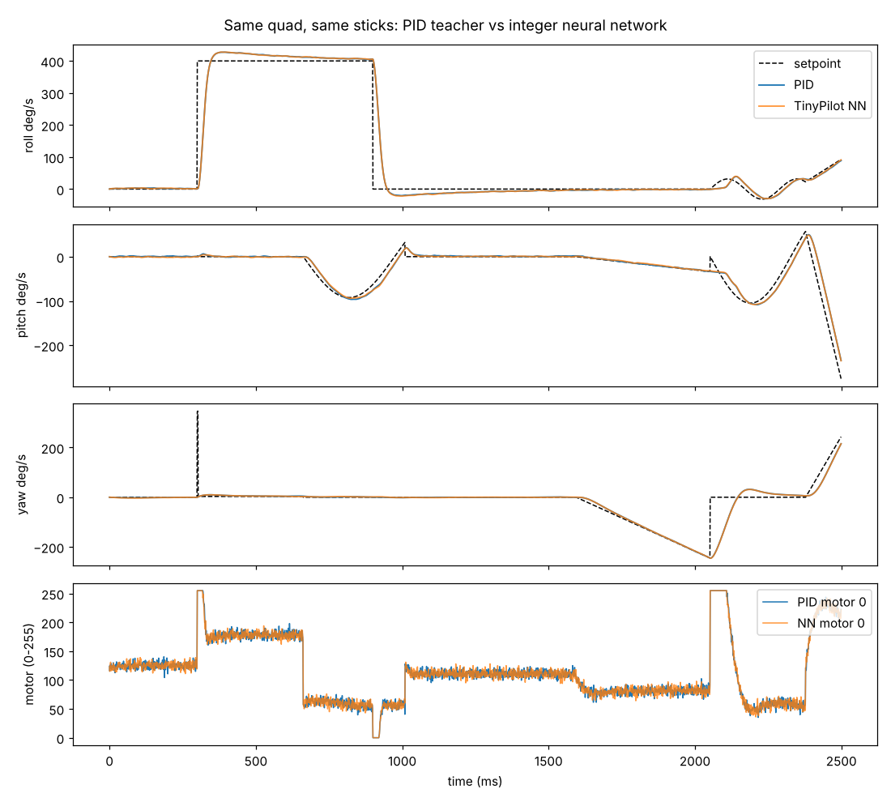

# TinyPilot: a drone rate controller turned into a hard-wired neural network

A companion to [TinyLM](../TinyLM). It takes a Betaflight-style PID rate
controller, trains a small integer neural network to imitate it, and builds
that network into Verilog with an SPI interface and Oneshot125 ESC outputs.



## Results

Held-out evaluation: 8 randomised quads (inertia, thrust, motor lag, gyro
noise and disturbance torque all vary), 6 s of aggressive flying each. RMS
rate-tracking error in deg/s:

| Controller | Roll | Pitch | Yaw |
|---|---|---|---|
| Float PID | 39.0 | 51.4 | 42.8 |
| PID on the integer front end (the teacher) | 40.3 | 54.6 | 42.8 |
| **TinyPilot neural net (bit-exact integer)** | **40.5** | **54.4** | **42.9** |

Hardware:
- `make test`: the chip runs 400 closed-loop control loops over SPI and every
  motor byte matches the Python model, as does the Oneshot125 pulse width.
- Latency: 337 cycles per control step (6.7 µs at 50 MHz; the loop period is 1 ms).
- Size: about 5,550 gates plus 812 flip-flops (roughly 8 Tiny Tapeout tiles), or
  1,996 LUTs on an iCE40UP5K.

## How it works

```
SPI frame (setpoints, gyro, throttle)
  → integer front end: error, filtered gyro derivative, clamped integrator  (state)
  → MLP 10 → 24 (ReLU) → 4, int8 weights, one multiply-accumulate per clock (stateless)
  → 4 motor bytes → Oneshot125 ESC pulses
```

- The network has no memory, so the integrator and derivative filter stay as
  ordinary logic. The network replaces the PID gains, the mixer and the
  motor-saturation handling.
- Training is **behaviour cloning plus DAgger**: fly with the network, label
  the states *it* visits with the teacher's action, and retrain. This is
  combined with quantisation-aware training, as in TinyLM.
- **Lesson learned:** int4 weights gave a motor error of 37/255; int8 weights
  give 2/255. Control needs precise gain ratios, while the character language
  model managed with ternary weights.

## Honest conclusions

- **Cloning a PID can at best equal the PID.** Beating it needs reinforcement
  learning against flight performance, plus careful sim-to-real work.
- PID is near-optimal for this almost-linear inner loop. It is also
  debuggable and has known stability margins. A network has neither.
- A custom chip adds nothing for the control loop. About 340 multiply-adds per
  millisecond is trivial for a $5 microcontroller, and the motors (about 20 ms
  response) are the real limit.
- Neural networks and custom silicon *do* pay off for perception (vision
  networks), for aggressive racing policies, and for milliwatt-budget nano
  drones.
- **Safety:** never fly a learned controller on a real drone without
  propellers-off testing and an independent failsafe. The simple arming
  logic here is not a failsafe.

## Run it

```bash
make train      # ~2.5 min, NumPy only
make gen test   # Verilog + closed-loop replay test
make plot       # docs/flight.png (matplotlib)
make synth-tt synth-ice40
```

Files: `model/quad_sim.py` (physics simulator and PID), `model/pilot.py`
(bit-exact chip model), `model/train.py`, `model/gen_verilog.py`,
`rtl/pilot_core.v`, `rtl/spi_slave.v`, `rtl/oneshot125.v`,
`rtl/tt_um_tinypilot.v`, `tb/tb_pilot.v`.
